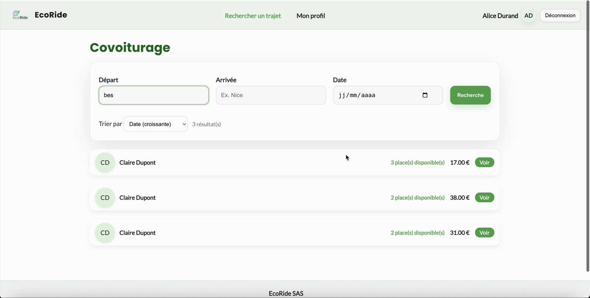
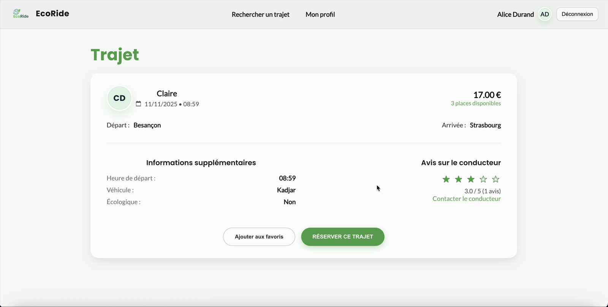
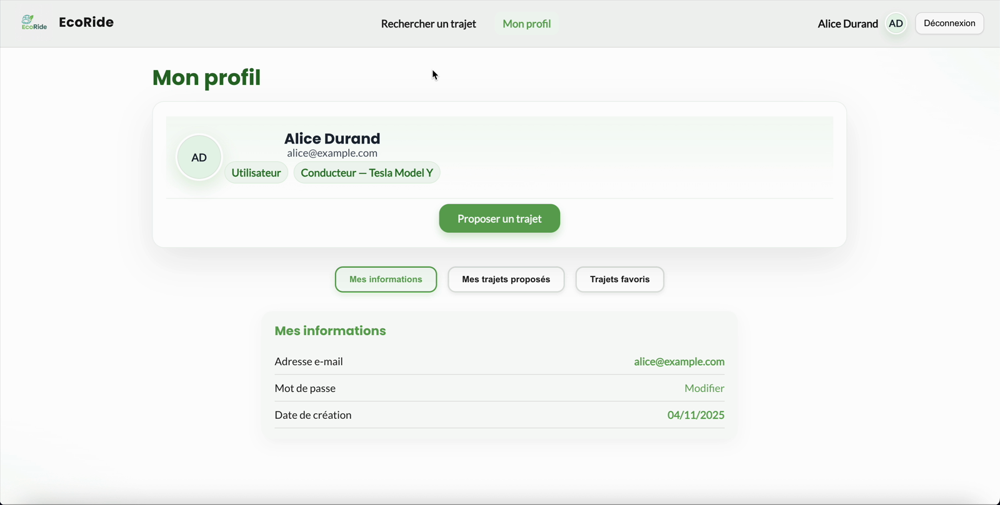
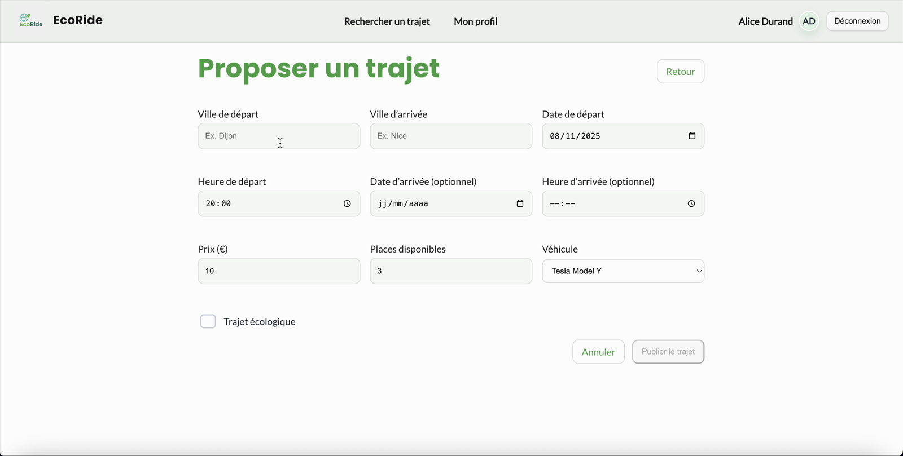
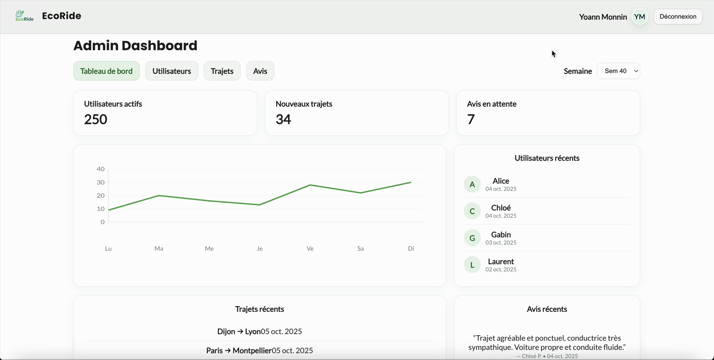

# EcoRide – Frontend (Angular)

Interface web de **EcoRide**, une plateforme de covoiturage écologique réalisée pour l'évaluation **ECF – Développeur Web et Web Mobile (Studi)**, rendue le 14 novembre 2025. Elle consomme l'API Symfony du dépôt [Ecoride-backend](https://github.com/Yoann04/Ecoride-backend).

> **Statut** : projet de formation terminé. Il a été mis en ligne sur AlwaysData pendant la formation et **n'est plus en ligne aujourd'hui**. Il se lance en local.

## Aperçu

| Recherche de trajets | Détail d'un trajet | Profil |
|---|---|---|
|  |  |  |

| Proposer un trajet | Accueil | Espace administrateur |
|---|---|---|
|  |  |  |

## Pages

- Accueil, connexion, inscription, mot de passe oublié
- Recherche de trajets (départ, arrivée, date, tri par date ou prix), détail d'un trajet, avis du conducteur
- Réservation, favoris, mes réservations, mes trajets de conducteur
- Proposer un trajet, gérer ses véhicules, profil et avatar, contacter un conducteur
- Administration : tableau de bord, utilisateurs, trajets, avis. ⚠️ Les chiffres du tableau de bord sont des **valeurs d'exemple**.

Routes protégées par guards (`authGuard`, `guestGuard`, `adminGuard`), chargement différé des pages (lazy loading), intercepteur HTTP pour le jeton JWT.

## Stack

Angular 20, TypeScript 5.9, SCSS responsive, composants standalone, API REST Symfony 7.1 / JWT / MySQL (autre dépôt).

## Lancer en local

1. Démarrer l'API (voir le README de [Ecoride-backend](https://github.com/Yoann04/Ecoride-backend)) sur le port 8000.
2. Puis :

```bash
git clone https://github.com/Yoann04/Ecoride-frontend.git
cd Ecoride-frontend
npm install
npx ng serve        # http://localhost:4200
```

`proxy.conf.json` redirige `/api` et `/uploads` vers `http://localhost:8000`. Pour un autre port, modifier ce fichier.

## Limites connues

- Tableau de bord admin non relié à de vraies statistiques
- Tests unitaires minimaux
